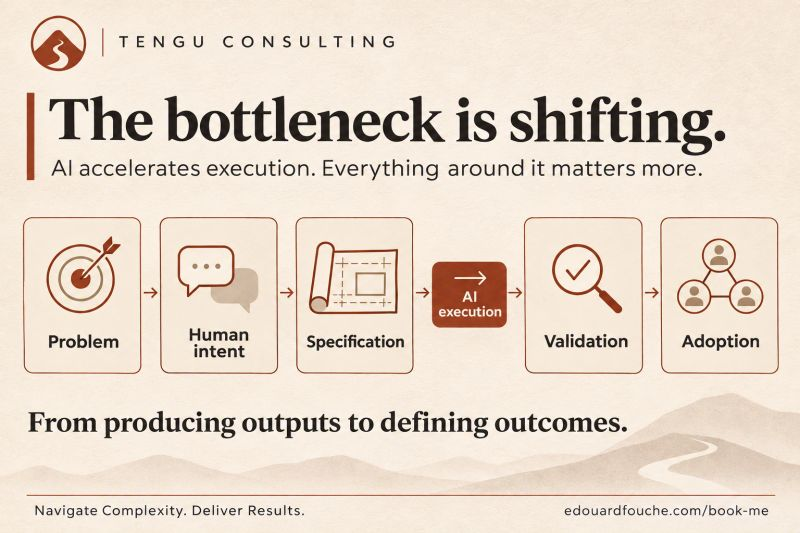

That sounds dramatic. Increasingly, I don't think it is.

Software writes software. AI generates reports, presentations, analyses, documentation, and prototypes at a speed that would have seemed absurd only a few years ago.

<!--more-->
 
{:class="img-responsive"}
{:style="max-width: 600px; margin: auto"}
 

**As a result, the scarce skill is shifting.**

It is becoming less about producing the thing and more about **figuring out what the right thing to build actually is.**

Then comes something surprisingly difficult: **extracting the real requirements from humans**, including the ones they struggle to articulate themselves, and translating them into specifications precise enough for AI to execute.

And once the technology works, new challenges begin:

- Getting it through the processes, governance, and organizational complexity of a large corporation without losing speed.
- Getting people to trust it.
- Getting people to actually change how they work.

So perhaps the emerging knowledge-work stack looks something like this:

**Problem → Human intent → Specification → AI execution → Validation → Adoption**
{:style="text-align: center"}

**AI is collapsing the cost and time of the execution step**, thus everything around it suddenly matters much more.

This is why I find the current moment both incredible and disturbing.

*P.S.* The new [Stanford AI100 report](https://hai.stanford.edu/news/the-world-has-changed-insights-from-the-new-ai100-report) reaches a similar conclusion at a much broader societal scale: AI is transforming science, software, cybersecurity, media, geopolitics, and even warfare faster than our institutions and governance are adapting.
